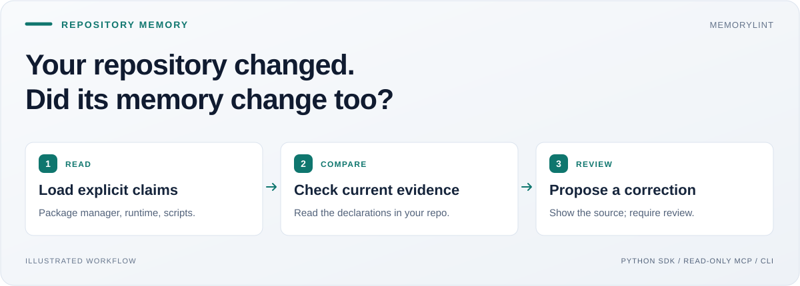
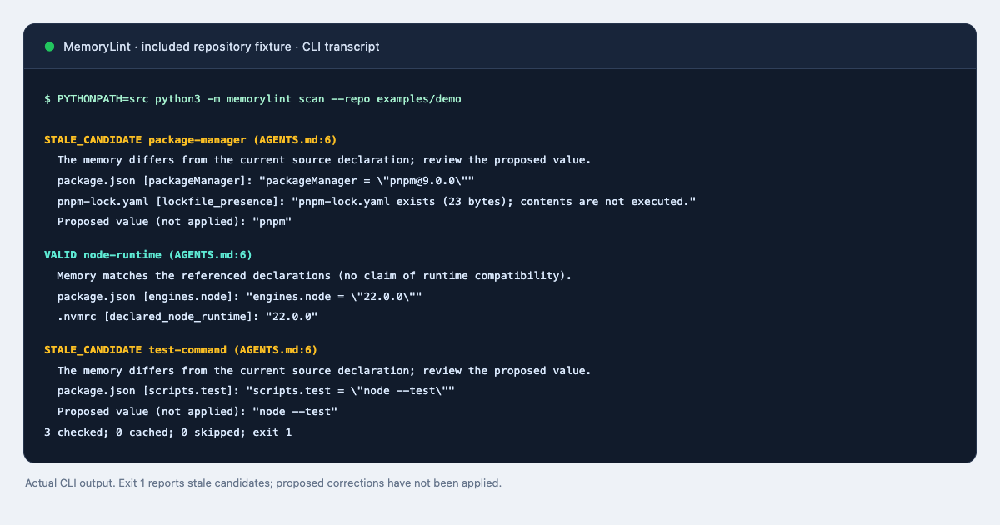
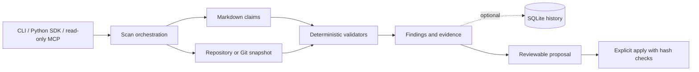

<h1 align="center">MemoryLint</h1>
<p align="center"><strong>Keep an assistant's repository memory aligned with the code.</strong></p>
<p align="center">Check saved claims against source evidence. Review what changed. Apply only the correction you approve.</p>

<p align="center">
  <a href="https://github.com/Balaji91221/memorylint/actions/workflows/ci.yml"></a>
  <a href="LICENSE"></a>
  
  
</p>
<p align="center">
  <a href="#why-i-built-it">Why</a> · <a href="#quick-start">Quick start</a> · <a href="#usage">Usage</a> · <a href="#architecture">Architecture</a> · <a href="#docs">Docs</a>
</p>



MemoryLint is a Python library and local tool for engineers building persistent coding assistants. It checks explicit claims in Markdown against the repository's package manager, declared Node version, and scripts. Every finding includes source evidence, so an assistant or a person can decide what to do next.

## Why I built it

As an AI engineer, I want memory to carry evidence as well as instructions. A saved instruction can outlive the code that made it correct. I built MemoryLint to make that drift inspectable: deterministic checks for facts the repository can establish, an explanation for each finding, and a separate review step before an edit.

### The problem → the solution

| When this happens | MemoryLint helps by |
|---|---|
| `AGENTS.md` says “use npm,” but `package.json` declares pnpm | Flagging the saved claim and showing the declaration and source hash |
| Memory says `jest`, but the test script is now `node --test` | Proposing a specific replacement that you can inspect as a diff |
| `.nvmrc` and CI declare different Node versions | Reporting a conflict instead of choosing a source silently |
| Evidence changes while a correction is being reviewed | Rejecting an outdated patch and requiring a fresh proposal |

### What you get

- **Evidence-backed checks** for three explicit claim types, with source paths, selectors and hashes.
- **Consistent reads** from cached working-tree files or immutable Git commit blobs.
- **Optional SQLite history** with claim dependencies, scan records and review decisions.
- **Reviewable corrections** with hash checks, an explicit apply operation and an audit trail.
- **SDK, CLI and read-only MCP** for a local workflow or integration into an assistant.

## Quick start

Requires Python 3.10+. The base runtime uses the standard library; no model account is needed. Install from source—`memorylint-local` is not published on PyPI.

```bash
git clone https://github.com/Balaji91221/memorylint.git
cd memorylint
python3 -m venv .venv
source .venv/bin/activate
python -m pip install .
memorylint scan --repo examples/demo
```

On Windows, activate with `.venv\Scripts\activate`.

The authored demo deliberately has two stale claims. Expect:

| Claim | Result | Evidence points to |
|---|---|---|
| `package-manager` | `stale_candidate` | `pnpm` |
| `node-runtime` | `valid` | `22.0.0` |
| `test-command` | `stale_candidate` | `node --test` |

**Exit 1 is the expected result:** a claim needs review. Exit 0 means evaluated claims are valid; exit 2 means an unsupported or incomplete check. Scan commands do not change memory.



*Local fixture output from `examples/demo`; this is an inspection tool, not a live-model benchmark.*

## Usage

### Call the Python SDK

Run this from the repository root after installation:

```python
from memorylint import scan_memory, propose_patch

result = scan_memory("examples/demo")
for finding in result.findings:
    print(finding.claim.id, finding.status, finding.proposed_value)

patch = propose_patch("examples/demo", "package-manager")
print(patch.diff)  # Review the proposed npm → pnpm change; nothing is applied.
```

Your Markdown needs a `memorylint` JSON block. Ordinary prose is not automatically asserted as true. See the [claim format and source rules](docs/usage.md#explicit-markdown-claims), [SQLite history](docs/usage.md#sqlite-history-and-dependency-cache), and [review/apply workflow](docs/usage.md#propose-review-explicitly-apply).

### Connect an MCP client

Add this server entry to a client that accepts `mcpServers` configuration. Replace both absolute paths with your virtual environment and target repository:

```json
{
  "mcpServers": {
    "memorylint": {
      "command": "/absolute/memorylint/.venv/bin/memorylint",
      "args": ["serve", "--repo", "/absolute/target-repo", "--memory", "AGENTS.md"]
    }
  }
}
```

Call `memorylint_scan` with `{}` or `memorylint_explain` with `{"claim_id":"package-manager"}`. The server fixes the repository and memory paths at startup. It exposes **read-only** checks; applying corrections stays an explicit CLI/SDK operation. [Protocol details →](docs/usage.md#read-only-mcp-integration)

### Add optional capabilities

```bash
python -m pip install '.[ci]'  # PyYAML support for ordinary GitHub Actions YAML
```

JSON-compatible workflows need no extra. An optional [extraction provider](docs/api/provider.md) can turn selected prose into review-required candidates. Deterministic validators still check the candidates; a model cannot authorize a memory edit.

## Architecture



| Component | Responsibility |
|---|---|
| [scanner.py](src/memorylint/scanner.py) | Coordinate parsing, evidence reads, validation and completeness |
| [models.py](src/memorylint/models.py), [validators.py](src/memorylint/validators.py) | Keep claims, findings and deterministic comparison rules together |
| [evidence.py](src/memorylint/evidence.py), [ci.py](src/memorylint/ci.py) | Enforce source boundaries and parse supported declarations |
| [index.py](src/memorylint/index.py), [review.py](src/memorylint/review.py) | Own history, proposal validation and guarded application |
| [mcp.py](src/memorylint/mcp.py), [extraction.py](src/memorylint/extraction.py) | Provide separate read-only tool and optional provider boundaries |

[Read the HLD, LLD, contracts and design tradeoffs →](docs/architecture.md)

### Deliberate boundaries

MemoryLint checks declarations, not installed runtimes or semver compatibility. Missing evidence is unresolved; arbitrary prose is not a verified fact. Corrections use optimistic concurrency, so Git snapshots are preferable when a coherent historic view matters. No hosted memory service or background rewrite is included.

## Docs

| Learn or build | Start here |
|---|---|
| Install, scan, review, apply and integrate | [Usage guide](docs/usage.md) |
| Understand component responsibilities and state | [Architecture](docs/architecture.md) |
| Add an extraction provider | [Provider contract](docs/api/provider.md) |
| Check implemented scope and evidence | [Implementation status](IMPLEMENTATION_STATUS.md) · [Original plan](PROJECT_PLAN.md) |
| Contribute or report a vulnerability | [Contributing](CONTRIBUTING.md) · [Security](SECURITY.md) |

Run the source checks from the repository root:

```bash
PYTHONPATH=src python -m unittest discover -s tests -v
PYTHONPATH=src python -m memorylint evaluate --dataset evals/heldout.json
```

The local source suite passed 44 tests with the optional YAML extra; a base install skips seven YAML tests. Current hosted results are in the CI badge above. Fixture replay results do not establish live-model accuracy.

MIT licensed. See [LICENSE](LICENSE) and [CHANGELOG.md](CHANGELOG.md). Version 0.2.0 is a development release with public source; PyPI publication and independent pilots remain separate steps.
