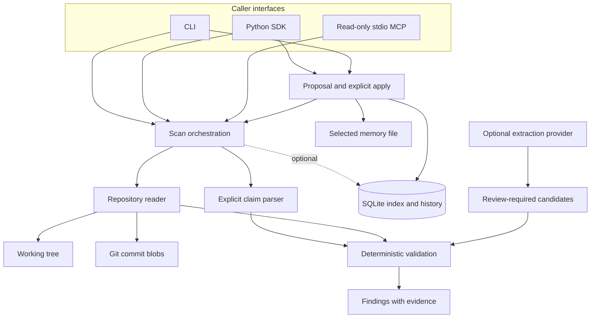
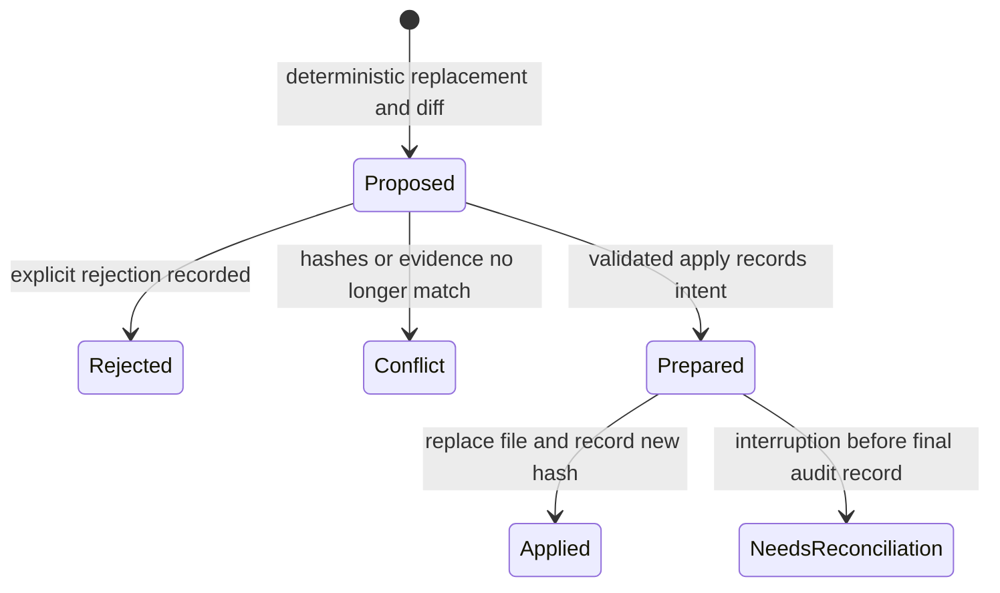

# MemoryLint architecture

[README](../README.md) · [Usage](usage.md) · [Implementation status](../IMPLEMENTATION_STATUS.md)

This document describes the implemented 0.2.0 system. It explains how responsibilities, contracts and failure states fit together; the [original project plan](../PROJECT_PLAN.md) records broader design proposals.

## Goal and system boundary

MemoryLint answers a narrow question: **does this explicit repository-memory claim match its declared source evidence?** A claim about a package manager, Node declaration or script command can be checked without asking a model to judge truth. The result is a finding with provenance, not an instruction to execute code.

The deployment is a local Python package. A CLI, an importing Python process or a stdio MCP client can invoke checks. Git is used for revision-aware operations; SQLite is optional for history and required for applying a reviewed patch. No database server, background worker, vector store or hosted API is needed.

## High-level design



The MCP interface only reaches scan/explain behavior. It cannot choose a different root, run a provider, open an index or apply a correction. An extraction provider is an explicitly configured extension with a separate data boundary.

## Low-level responsibilities

| Module | Owner of | Main contracts |
|---|---|---|
| [models.py](../src/memorylint/models.py) | Immutable domain records and result semantics | `Claim`, `Evidence`, `Finding`, `ScanResult` |
| [parser.py](../src/memorylint/parser.py) | JSON blocks embedded in Markdown, claim shape and locations | `parse_claims(text, path)` returns claims and input errors |
| [evidence.py](../src/memorylint/evidence.py) | Root/scope/path constraints, bounded reads, hashes and source extraction | `Repository`, `evidence_items(repo, claim, ref)` |
| [ci.py](../src/memorylint/ci.py) | Literal workflow parsing and strict optional YAML handling | `load_workflow(content, ref)` |
| [validators.py](../src/memorylint/validators.py) | Supported-kind comparison and conflicts | `validate(claim, evidence) -> Finding` |
| [scanner.py](../src/memorylint/scanner.py) | Full scan workflow, filtering, consistency and optional index recording | `scan_memory(...) -> ScanResult` |
| [index.py](../src/memorylint/index.py) | SQLite schema, dependency cache, history, review audit and backup | `DependencyIndex` |
| [review.py](../src/memorylint/review.py) | Proposal data and guarded file replacement | `propose_patch(...)`, `apply_patch(...)` |
| [extraction.py](../src/memorylint/extraction.py) | Candidate extraction request, provider limits and response validation | `ExtractionProvider.complete(request, limits)` |
| [cli.py](../src/memorylint/cli.py), [mcp.py](../src/memorylint/mcp.py) | Input parsing, presentation and protocol composition | CLI exit mapping; root-bound `MemoryServer` |

### Public SDK contracts

```python
scan_memory(
    repo, memory_paths=("AGENTS.md",), *,
    changed_since=None, revision=None, index_path=None,
) -> ScanResult

propose_patch(repo, claim_id, memory_paths=("AGENTS.md",)) -> ProposedPatch

apply_patch(repo, patch, *, index_path, expected_hash=None) -> dict
```

These are signature summaries; import implementations from `memorylint`. `changed_since` and `revision` are mutually exclusive. Paths in claims remain relative to the configured repository, including when a claim specifies a narrower scope.

## One scan, end to end

1. `scan_memory` constructs the repository reader and validates memory paths and revision/filter options.
2. The parser extracts explicit `memorylint` blocks, retaining the memory path and line location. Ordinary prose remains outside deterministic checking.
3. The scanner reads each named evidence source. The reader enforces repository/scope boundaries and records content hashes; source-specific extraction yields selectors and short excerpts.
4. Validators normalize supported declarations and produce `valid`, `stale_candidate`, `conflict` or `unsupported`. Contradictory declarations stay visible instead of silently picking one.
5. Working-tree sources are read again to detect observed concurrent edits. Revision mode reads regular blobs from one resolved Git commit.
6. The scanner creates a schema-2 report with findings, errors, hashes, revision, snapshot ID and run ID. If requested, the index records the scan and updates eligible cache entries.

A cache hit reuses a finding with an unchanged claim/evidence signature. It does not remove the requirement to read and hash source dependencies.

### Result and exit semantics

| State | Meaning | CLI consequence |
|---|---|---|
| `valid` | Supported declarations agree with the saved value | Eligible for exit 0 |
| `stale_candidate` | Current evidence yields a different unambiguous value | Exit 1; may support a proposal |
| `conflict` | Authoritative declared sources disagree | Exit 1; resolve evidence manually |
| `unsupported` or a scan error | The check cannot establish a result | Exit 2 |

`complete` is about input/I/O errors, not a substitute for `exit_code`. A filtered scan may evaluate no claims; inspect skipped counts. Missing evidence does not become a pass.

## Persistence and review state

The SQLite schema is version 1. `scans`, `claims` and `evidence` retain scan history. `current_claims` and `dependencies` hold the replaceable cache, scoped by repository, memory-file set and revision. Scans with input/I/O errors or `changed_since` filtering remain audit data but cannot replace the full-scan cache. `reviews` stores explicit decisions.



`propose_patch` is read-only. It includes the old/new claim values, the displayed diff, the memory hash and source hashes. `apply_patch` requires an audit index and an exclusive repository lock, rechecks hashes, regenerates the deterministic proposal, and verifies the diff. It writes a temporary file, flushes it, checks observed source consistency, then replaces the selected memory file.

The lock coordinates MemoryLint writers; it is not an operating-system compare-and-swap against hostile external writers. A crash after `prepared` requires comparing the recorded new hash with the current file. A repeated stale apply is rejected; it is not a blind replay mechanism. Unknown SQLite schemas are rejected, and backups refuse overwrite.

## LLM boundary

The core scan and review paths need no LLM. Optional extraction supplies selected Markdown and approved source contents to an `ExtractionProvider`. `FixtureProvider` replays data; `CommandProvider` runs a configured argv without shell interpolation and exchanges JSON through stdio.

Candidates must quote actual input and name approved paths. Output shape, bytes, elapsed time, token reports and cost reports are validated. Candidates remain `review_required` and receive deterministic findings. They cannot authorize file changes or become accepted memory automatically.

A command provider owns any remote transport, credentials and admission control before billing. MemoryLint cannot reverse charges or independently prove reported cost. In-process providers must honor their deadline contract. See the [provider protocol](api/provider.md) for the concrete wire format.

## Design choices and extension points

| Choice | Benefit | Tradeoff |
|---|---|---|
| Explicit claims before free-form truth checking | Precise, explainable comparisons | Users must structure supported facts |
| Local SQLite history | Simple transactional audit and dependency lookup | No multi-tenant service or distributed coordination |
| Immutable Git reads plus checked working-tree reads | Clear historic evidence; practical current-state scans | Working-tree checking is optimistic |
| Separate proposal and application | Caller can inspect the exact correction | Application needs an audit store and conflict handling |
| Optional extraction protocol | Model/provider changes do not define truth semantics | Live extraction quality needs separate evaluation |

The design uses small functions and data records rather than a general inheritance hierarchy. Responsibilities change separately: adding source syntax belongs in evidence parsing, adding comparison semantics belongs in validators, and transport belongs in adapters. New claim kinds require explicit schema and validation work; they are not arbitrary plugins.

The extraction protocol is deliberately small. Every provider must meet the same shape, attribution and limit contract; a replacement provider cannot weaken those guarantees. High-level extraction consumes that contract while the CLI selects the concrete provider. The deterministic scanner directly composes its small local modules, avoiding a service/container abstraction with no current consumer.

## Validation and operations

The [test suite](../tests) covers stale/conflicting claims, traversal, evidence changes, Git snapshots, SQLite history, patch conflicts, provider bounds and actual MCP stdio calls. The optional-dependency test loads only MemoryLint under isolated Python flags, exercising the installed wheel without accidentally exposing sibling site packages.

Use [IMPLEMENTATION_STATUS.md](../IMPLEMENTATION_STATUS.md) for recorded local evidence and the [workflow](https://github.com/Balaji91221/memorylint/actions/workflows/ci.yml) for current hosted results. Keep index files and reports private when their source excerpts are sensitive. There is no automatic migration or hosted operations layer; preserve history and test a backup before a future schema migration.
